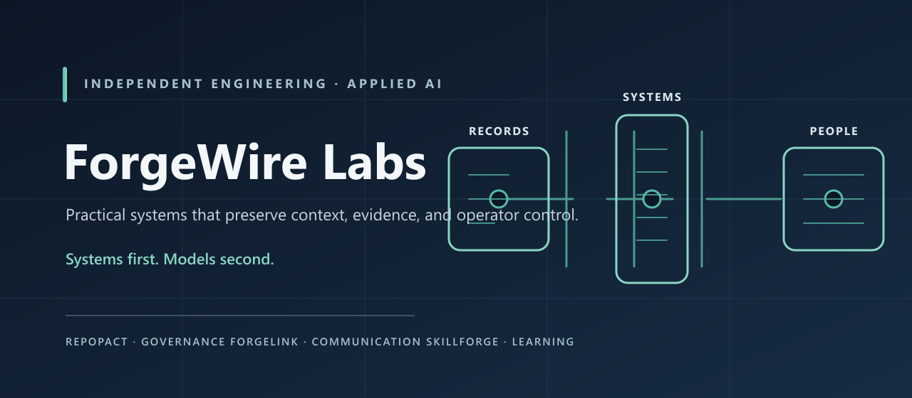
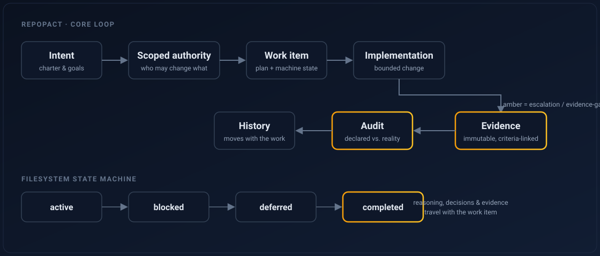
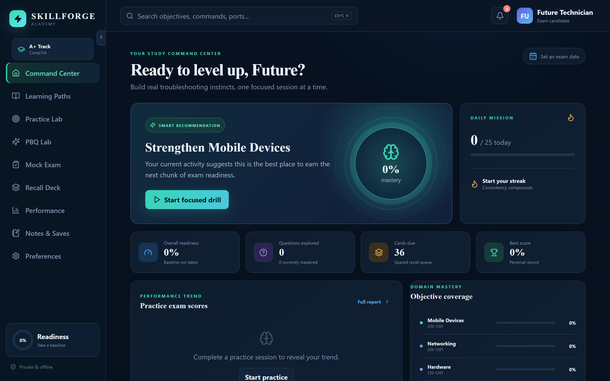

# ForgeWire Labs

Independent engineering and applied AI. I build practical software for governed work, planning, communication, and structured learning. Each project has a distinct purpose and its own stage of availability.

**Available to explore now:** [RepoPact Core](https://github.com/ForgeWireLabs/repopact-core) is a released CLI; [SkillForge Academy](https://github.com/ForgeWireLabs/skillforge-academy) has a published Windows app; [ForgeLink](https://github.com/JeremyShows/ForgeLink) and [Anvil](https://github.com/ForgeWireLabs/anvil) are public early-stage projects. **RepoPact Workbench** is a source-build preview. The ForgeWire application and Fabric remain private development, with no public download or release date.

[Start with RepoPact Core](https://github.com/ForgeWireLabs/repopact-core) · [Explore Workbench](https://github.com/ForgeWireLabs/repopact-workbench) · [Browse all projects](#what-forgewire-labs-builds)

---

## Jeremy Shows

**Founder & Principal Engineer, ForgeWire Labs**

I build software for people working with AI agents: repository tools that track decisions and evidence, practical applications, and clear paths for human review. The work has to hold up when a model makes a mistake, a machine fails, or the operator needs to step in.

I work on the research, architecture, code, debugging, tests, and documentation with substantial help from AI systems. I choose the tools and design, check their output, and decide what gets accepted. The projects also draw on open research, open-source software, commercial tools, and established engineering practice.

I was a mechanic, race-car builder, fabricator, IT professional, and small-business owner before working on distributed systems and AI software. That background shapes how I build: I look for the parts, their connections, and what happens when one fails. A demo has to survive contact with limited hardware, changing requirements, and operator intervention.

> **Build it. Test it under failure. Preserve the evidence. Understand its limits. Then decide whether it is useful.**

---

## What ForgeWire Labs Builds

ForgeWire Labs builds software for governed work, planning, communication, and structured learning.

The projects cover different parts of that work. Some have public repositories; others are still private:

| Project | What it is | Availability |
| --- | --- | --- |
| [RepoPact Core](https://github.com/ForgeWireLabs/repopact-core) | Repository-native governance CLI and canonical engine | Released CLI; ongoing development |
| [RepoPact Workbench](https://github.com/ForgeWireLabs/repopact-workbench) | Native interface for exploring RepoPact records and reviewing supported changes | Source-build preview |
| [Anvil](https://github.com/ForgeWireLabs/anvil) | Local-first planning ledger | Public developer preview |
| [SkillForge Academy](https://github.com/ForgeWireLabs/skillforge-academy) | Structured learning application | Published Windows app; course-platform work in beta |
| [ForgeLink](https://github.com/JeremyShows/ForgeLink) | Locally owned communication and coordination | Public repository; latest packaged release v2.0.1, with main at v2.0.3 per its current README |
| ForgeWire and Fabric | Private projects in development | No public download or release date |

The common concern is practical: people need to know what ran, what it changed, and what to do when it fails.

---

## Project details

### 📜 [RepoPact Core](https://github.com/ForgeWireLabs/repopact-core) · **Released CLI · Ongoing Development**

[](https://github.com/ForgeWireLabs/repopact-core/blob/main/LICENSE)

A **repo-native kernel for durable work between humans and coding agents**.

The stable CLI/headless package is available through PyPI as `repopact`. It includes the Python command surface and canonical Rust semantic engine; the source tree continues to evolve separately from the published release.

RepoPact keeps authority, intent, work state, evidence, decisions, drift checks, and project history inside the repository instead of letting them vanish with each agent session. Claude Code, Codex, Cursor, OpenHands, VS Code agents, and other coding tools can use that repository state.

```text
intent → scoped authority → work item → implementation → evidence → audit → history
```

RepoPact makes short prompts possible because the repository carries the operating context. A prompt like:

```text
Proceed to the next active work item.
```

can be meaningful when the repo already defines active work, invariants, evidence gates, validation rules, completion protocol, and update expectations.

RepoPact does not replace coding agents. It gives them a durable operating environment.

[RepoPact Workbench](https://github.com/ForgeWireLabs/repopact-workbench) is the separate Tauri 2 desktop/mobile application in development. Its build, packaging, and platform acceptance are independent of the released Core package.

`coding-agents` · `repository-governance` · `agents-md` · `developer-tools` · `ai-governance`



---

### 🔨 [ForgeWire Anvil](https://github.com/ForgeWireLabs/anvil) · **Developer Preview**

A **local-first planning ledger for human and agentic work**.

Anvil owns projects, issues, boards, sprints, workflows, and typed relations to external work records. Its built-in store uses local JSON with no required network service or external issue-tracker account. The current developer preview has a single-writer store; its API and schema may change.

Anvil owns planning state. RepoPact owns repository governance, and ForgeLink owns communication and human decisions. References between public projects do not transfer authority or duplicate the authoritative records.

Anvil is published as an Apache-2.0 mirror of private monorepo development. Issues are welcome; pull requests are not accepted in the mirror.

---

### ☎️ [ForgeLink](https://github.com/JeremyShows/ForgeLink) · **Public Repository · Packaged Release v2.0.1**

A locally owned **communications and coordination platform for people, agents, and applications**.

People can use ForgeLink directly to communicate, manage contacts and channels, review history, and control communication policy. Agents and applications participate through governed local interfaces, including requests for attention or approval. Communication state, operator decisions, and authority remain locally owned.

```text
human / agent / channel → governed communication state → decision → recorded outcome → replay
```

ForgeLink's current README lists a packaged v2.0.1 release and repository version 2.0.3; `main` is ahead of the latest installer, so check the [release notes](https://github.com/JeremyShows/ForgeLink/releases) for the exact packaged feature set. The repository describes SMS/MMS through Twilio and Telnyx, Twilio Voice, call history, contacts, approval requests with supporting evidence, signed decision records, and an audit chain. It runs as an Electron/TypeScript app with local SQLite storage, an MCP bridge, and backup/export tools. A shared-cockpit/Tauri transition and mobile work are in progress; Electron remains the current packaged desktop runtime until its parity and retirement gates are satisfied.

It is not a phone clone, social feed, public messaging platform, work runner, or hosted notification relay. It is a private operator boundary for human-agent communication.

`human-in-the-loop` · `operator-cockpit` · `communications-runtime` · `mcp` · `electron` · `agentic-ai`

---

## Product Work

### 🎓 [SkillForge Academy](https://github.com/ForgeWireLabs/skillforge-academy) · **Published Windows App · Course Platform in Beta Development**

[](https://github.com/ForgeWireLabs/skillforge-academy/releases)

An **offline-first learning platform built around structured courses, guided instruction, practical application, and measurable mastery**.

Certification preparation is one use of the platform. The certification workspace includes CompTIA A+, Network+, and Security+ tracks with original lessons and practice material, performance-based exercises, mock exams, spaced-repetition cards, analytics, notes, and bookmarks.

The published Windows release and current course-platform development have different maturity boundaries. Current main includes a reusable course runtime and validated local `.skillforge-course` package import/export. Course-platform features remain in beta development, with migration, persistence, backup, and acceptance work still open. See the project's [maturity matrix](https://github.com/ForgeWireLabs/skillforge-academy/blob/main/docs/feature-maturity.md) before treating development features as released behavior.

SkillForge is built with Tauri, Rust, React, and TypeScript and is open source under Apache-2.0. Learner state is local, and the application requires no account or cloud service. It is independently useful and shares the wider portfolio's emphasis on durable state and practical usefulness.

`structured-learning` · `course-platform` · `exam-prep` · `tauri` · `rust` · `react` · `offline-first`



*Certification study workspace preview; this image does not represent the newer course-platform surfaces or establish their release readiness.*

---

## ForgeWire in development

ForgeWire is a private application under development. It has no public build, supported install path, stable API, or announced release date. The public [ForgeWire overview](https://github.com/ForgeWireLabs/ForgeWire-Overview) presents its current high-level direction and availability boundary.

The public projects listed here stand on their own. RepoPact Core provides repository-native governance; Workbench is its separate source-build preview interface. ForgeLink, Anvil, and SkillForge Academy have their own repositories, scopes, and maturity levels. No project requires installing the private ForgeWire application.

---

## How I Build

I start by defining who owns an action, what data it can use, and how a failure will appear to the operator. Evidence comes from the code, tests, and behavior of the running system.

When a proposed fix keeps failing, I revisit the design instead of adding another patch. I keep decisions and evidence in the repository so a later session can pick up the work. Experimental ideas go through isolated trials and comparison with a baseline before they enter the application.

I prefer local storage for private state and operator decisions. Software that acts on a person’s behalf should make its scope clear and leave a record of what happened. These choices are visible across the public projects, though each project is at a different stage.

**Stack:** Rust · Python · TypeScript · React · Tauri · Electron · GTK · SQLite · rqlite · PostgreSQL · PowerShell · GitHub Actions

---

## Lineage & Archive

The current work descends from years of building, failure, and reconstruction:

```text
SCOUT → SCOUT-2 → ATLAS → PhrenForge → ForgeWire
```

Across those generations, experiments in assistants and practical software led toward durable project context, clear authority boundaries, and systems-first engineering.

Historical projects:

- [SCOUT-2](https://github.com/ForgeWireLabs/SCOUT-2): *Historical.* Multi-agent assistant platform; a record of experiments, communication tools, agent patterns, and architectural limits that led to ForgeWire, ForgeLink, and later infrastructure.
- Earlier public projects (**SCOUT**, **Feed-Portal**, **MED.I.C.**) are *archived* and kept for history: not current work.

---


Reach me through the repositories above. Use the relevant project's security reporting process for suspected vulnerabilities.
